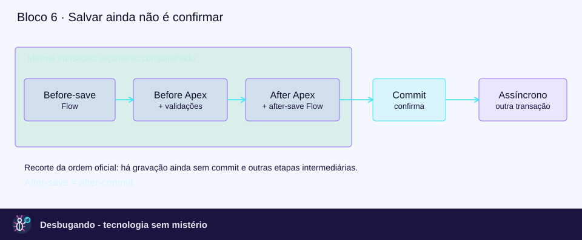

# Order of Execution no Salesforce

Este guia explica a gravação como um pipeline transacional, não como uma lista para decorar. A ordem define quando cada mecanismo participa; os governor limits definem o orçamento compartilhado pelo trabalho da transação ([ordem oficial](https://developer.salesforce.com/docs/platform/apex-dev/references/apex-dev/apex-triggers-order-of-execution.html), [limites Apex](https://developer.salesforce.com/docs/platform/apex-dev/references/apex-dev/apex-gov-limits.html)).

Revisão técnica: 11 de novembro de 2026, referência Winter ’27. Para a apresentação em blocos de até dez minutos, use o bloco 6 do [roteiro principal](roteiro-sf-para-techs/roteiro-salesforce-backend.md); aqui fica o aprofundamento.

## Escopo e analogia

A sequência numerada abaixo descreve o salvamento por `insert`, `update` e `upsert`, conforme o Apex Developer Guide. `delete` e `undelete` também têm eventos de trigger, mas não devem receber automaticamente todas as etapas dessa sequência de salvamento; não existe `before undelete` ([ordem de gravação](https://developer.salesforce.com/docs/platform/apex-dev/references/apex-dev/apex-triggers-order-of-execution.html), [eventos suportados](https://developer.salesforce.com/docs/platform/apex-dev/references/apex-dev/apex-triggers-defining.html)).

Analogia back-end: uma requisição abre uma unidade transacional que atravessa hooks e serviços. “After” significa depois de uma etapa de gravação, não depois da confirmação definitiva; chamar outra classe não cria uma transação nova nem renova as quotas ([ordem e limites](https://developer.salesforce.com/docs/platform/apex-dev/references/apex-dev/apex-triggers-order-of-execution.html), [governors](https://developer.salesforce.com/docs/platform/apex-dev/references/apex-dev/apex-gov-limits.html)).



## Visão resumida

```text
Requisição e validações iniciais aplicáveis
  → before-save Flow
  → before trigger
  → validações de sistema e regras customizadas
  → duplicate rules
  → gravação SEM commit
  → after trigger
  → regras intermediárias e possíveis reentradas
  → caminho imediato de after-save Flow
  → entitlement, roll-ups e sharing aplicáveis
  → COMMIT
  → execução posterior: Queueable e caminhos assíncronos
```

Esse desenho omite etapas para tornar visível a fronteira de commit. A tabela seguinte preserva a numeração oficial, inclusive Escalation Rules, e deve ser consultada quando a ordem intermediária importa ([sequência oficial](https://developer.salesforce.com/docs/platform/apex-dev/references/apex-dev/apex-triggers-order-of-execution.html)).

## Sequência oficial de salvamento

Todas as linhas desta tabela seguem [Triggers and Order of Execution](https://developer.salesforce.com/docs/platform/apex-dev/references/apex-dev/apex-triggers-order-of-execution.html). São etapas condicionais à operação, ao objeto, à origem e aos recursos configurados, não uma afirmação de que toda org executa todas elas.

| Etapa | O que acontece | Como interpretar |
|---:|---|---|
| 1 | Carrega o registro original ou inicializa o registro para upsert. | Estado de partida do salvamento ([guia](https://developer.salesforce.com/docs/platform/apex-dev/references/apex-dev/apex-triggers-order-of-execution.html)). |
| 2 | Aplica os valores recebidos e valida conforme a origem. | UI padrão e API/Apex não têm exatamente as mesmas verificações; não universalizar regras de layout ([guia](https://developer.salesforce.com/docs/platform/apex-dev/references/apex-dev/apex-triggers-order-of-execution.html)). |
| 3 | Executa record-triggered Flows before-save. | Antes dos before triggers; adequado para alterar campos do próprio registro sem DML adicional ([guia](https://developer.salesforce.com/docs/platform/apex-dev/references/apex-dev/apex-triggers-order-of-execution.html)). |
| 4 | Executa before triggers. | Neste ciclo, before insert/update; não incluir um evento inexistente de restauração ([guia de eventos](https://developer.salesforce.com/docs/platform/apex-dev/references/apex-dev/apex-triggers-defining.html)). |
| 5 | Repete a maior parte das validações de sistema e executa regras customizadas. | Regras customizadas veem as alterações feitas no before; há verificações antecipadas específicas, como em User e criação multilinha ([guia](https://developer.salesforce.com/docs/platform/apex-dev/references/apex-dev/apex-triggers-order-of-execution.html)). |
| 6 | Executa duplicate rules. | Se a ação bloquear, não avança para o salvamento e as etapas posteriores ([guia](https://developer.salesforce.com/docs/platform/apex-dev/references/apex-dev/apex-triggers-order-of-execution.html)). |
| 7 | Salva no banco sem commit. | A gravação ainda pode ser desfeita; não confundir com uma tabela temporária separada ([guia](https://developer.salesforce.com/docs/platform/apex-dev/references/apex-dev/apex-triggers-order-of-execution.html)). |
| 8 | Executa after triggers. | No after insert, o ID já está disponível, mas o commit ainda não aconteceu ([guia](https://developer.salesforce.com/docs/platform/apex-dev/references/apex-dev/apex-triggers-order-of-execution.html)). |
| 9 | Executa assignment rules. | Aplicabilidade depende do objeto e da configuração ([guia](https://developer.salesforce.com/docs/platform/apex-dev/references/apex-dev/apex-triggers-order-of-execution.html)). |
| 10 | Executa auto-response rules. | Não confundir e-mail automático com uma chamada Apex a `Messaging.sendEmail` ([guia](https://developer.salesforce.com/docs/platform/apex-dev/references/apex-dev/apex-triggers-order-of-execution.html), [limites Apex](https://developer.salesforce.com/docs/platform/apex-dev/references/apex-dev/apex-gov-limits.html)). |
| 11 | Executa workflow rules. | Field update tem uma reexecução específica de before/after update, descrita adiante ([guia](https://developer.salesforce.com/docs/platform/apex-dev/references/apex-dev/apex-triggers-order-of-execution.html)). |
| 12 | Executa escalation rules. | Etapa omitida na versão anterior deste arquivo ([guia](https://developer.salesforce.com/docs/platform/apex-dev/references/apex-dev/apex-triggers-order-of-execution.html)). |
| 13 | Executa Process Builder e flows lançados por workflow. | Sem ordem garantida entre esses mecanismos; DML pode iniciar outro ciclo no registro afetado ([guia](https://developer.salesforce.com/docs/platform/apex-dev/references/apex-dev/apex-triggers-order-of-execution.html)). |
| 14 | Executa record-triggered Flows after-save. | O caminho imediato ainda está antes do commit ([guia](https://developer.salesforce.com/docs/platform/apex-dev/references/apex-dev/apex-triggers-order-of-execution.html)). |
| 15 | Executa entitlement rules. | O guia registra posição diferente para after-save Flow em API 53.0 e anteriores; observar legado ao investigar ([guia](https://developer.salesforce.com/docs/platform/apex-dev/references/apex-dev/apex-triggers-order-of-execution.html)). |
| 16 | Recalcula roll-up/cross-object workflow no pai, quando aplicável. | O pai passa pelo procedimento de salvamento ([guia](https://developer.salesforce.com/docs/platform/apex-dev/references/apex-dev/apex-triggers-order-of-execution.html)). |
| 17 | Recalcula no avô, quando aplicável. | Cadeias de relacionamento podem ampliar o trabalho da transação ([guia](https://developer.salesforce.com/docs/platform/apex-dev/references/apex-dev/apex-triggers-order-of-execution.html)). |
| 18 | Avalia criteria-based sharing. | Etapa de acesso a registros, não FLS ([guia](https://developer.salesforce.com/docs/platform/apex-dev/references/apex-dev/apex-triggers-order-of-execution.html)). |
| 19 | Confirma as operações DML. | Commit da transação ([guia](https://developer.salesforce.com/docs/platform/apex-dev/references/apex-dev/apex-triggers-order-of-execution.html)). |
| 20 | Executa lógica pós-commit. | Exemplos: envio de e-mail, jobs Apex enfileirados e caminhos assíncronos de Flow; não há ordem garantida entre esses exemplos ([guia](https://developer.salesforce.com/docs/platform/apex-dev/references/apex-dev/apex-triggers-order-of-execution.html)). |

## Reentrada não é uma regra única

- **Workflow field update:** na reexecução específica dessa etapa, rodam novamente validações de sistema e before/after update uma única vez adicional. Não rodam novamente regras customizadas, flows, duplicate rules, processos de Process Builder e escalation rules por esse mecanismo específico; isso não proíbe que outro DML inicie outro ciclo ([documentação da etapa 11](https://developer.salesforce.com/docs/platform/apex-dev/references/apex-dev/apex-triggers-order-of-execution.html)).
- **Save recursivo documentado:** o guia diz que as etapas oficiais 9 a 17 são puladas durante um save recursivo. Não aplicar essa frase indiscriminadamente a todo segundo DML nem usar a numeração diferente de uma tabela local ([observação oficial sobre recursão](https://developer.salesforce.com/docs/platform/apex-dev/references/apex-dev/apex-triggers-order-of-execution.html)).
- **Valores anteriores:** no contexto da reexecução por workflow field update, `Trigger.old` conserva o valor anterior à atualização inicial, não o valor imediatamente anterior ao field update. Não generalizar isso como comportamento universal de qualquer segundo DML ([exemplo oficial](https://developer.salesforce.com/docs/platform/apex-dev/references/apex-dev/apex-triggers-order-of-execution.html)).
- **Vários triggers:** a ordem entre triggers do mesmo objeto/evento não é garantida. Um ponto de entrada com handler ajuda a ordenar a lógica da equipe, mas não elimina a necessidade de comportamento idempotente e controle de reentrada ([considerações oficiais](https://developer.salesforce.com/docs/platform/apex-dev/references/apex-dev/apex-triggers-order-of-execution.html)).
- **Legado ativo:** o fim do suporte de Workflow Rules e Process Builder em 31/12/2025 não desligou automaticamente todas as automações existentes. Elas continuam relevantes ao investigar o comportamento de uma org ([comunicado Salesforce](https://help.salesforce.com/s/articleView?id=001096524&language=en_US&type=1)).

## Governor limits: orçamento, não ordem de execução

Esta é uma seleção de limites gerais por transação Apex, não um inventário de todas as quotas da plataforma. Pacotes certificados e contextos especiais têm regras próprias, por isso o limite deve sempre ser lido com seu escopo ([referência oficial](https://developer.salesforce.com/docs/platform/apex-dev/references/apex-dev/apex-gov-limits.html)).

| Recurso | Síncrono | Assíncrono usual | Ressalva |
|---|---:|---:|---|
| Consultas SOQL | 100 | 200 | Outras automações também usam orçamento; há exceções documentadas ([limites](https://developer.salesforce.com/docs/platform/apex-dev/references/apex-dev/apex-gov-limits.html)). |
| Linhas SOQL | 50.000 | 50.000 | Não equivale ao alcance do QueryLocator de start em Batch ([limites](https://developer.salesforce.com/docs/platform/apex-dev/references/apex-dev/apex-gov-limits.html)). |
| Linhas de `Database.getQueryLocator` | 10.000 | 10.000 | Exceção: QueryLocator em Batch Apex alcança até 50 milhões de registros, processados em lotes, não todos carregados no heap ([limites](https://developer.salesforce.com/docs/platform/apex-dev/references/apex-dev/apex-gov-limits.html), [Batch Apex](https://trailhead.salesforce.com/content/learn/modules/asynchronous_apex/async_apex_batch)). |
| Instruções DML | 150 | 150 | Coleção de registros em um insert é uma instrução; linhas têm contador separado ([limites](https://developer.salesforce.com/docs/platform/apex-dev/references/apex-dev/apex-gov-limits.html)). |
| Linhas DML | 10.000 | 10.000 | Não confundir com tamanho do lote entregue ao trigger ([limites](https://developer.salesforce.com/docs/platform/apex-dev/references/apex-dev/apex-gov-limits.html)). |
| CPU | 10.000 ms | 60.000 ms | Não representa tempo de relógio total ([limites](https://developer.salesforce.com/docs/platform/apex-dev/references/apex-dev/apex-gov-limits.html)). |
| Heap Winter ’27 | 10 MB | 25 MB | Configuração transitória em ambientes não produtivos pode manter 6/12 MB; consultar `Limits.getLimitHeapSize()` ([release note](https://help.salesforce.com/s/articleView?id=release-notes.rn_apex_heap_limit.htm&language=en_US&type=5)). |
| Callouts | 100 | 100 | Também sujeitos ao timeout acumulado de 120 s ([limites](https://developer.salesforce.com/docs/platform/apex-dev/references/apex-dev/apex-gov-limits.html)). |
| Tempo de callouts | 120 s acumulados | 120 s acumulados | Timeout padrão individual: 10 s; não 120 s para cada uma de cem chamadas ([timeouts](https://developer.salesforce.com/docs/platform/apex-dev/references/apex-dev/apex-callouts-timeouts.html)). |
| Jobs com `System.enqueueJob` | 50 | 1 | Scheduled Apex usa limites síncronos; não aplicar a coluna assíncrona apenas pelo nome do mecanismo ([limites](https://developer.salesforce.com/docs/platform/apex-dev/references/apex-dev/apex-gov-limits.html)). |
| Chamadas `Messaging.sendEmail` | 10 | 10 | Chamadas Apex por transação, não número universal de mensagens nem regra de todos os e-mails automáticos ([limites](https://developer.salesforce.com/docs/platform/apex-dev/references/apex-dev/apex-gov-limits.html)). |

No Batch Apex, cada `execute` é uma transação com limites novos; isso não aumenta os limites de um único `execute` para todo o volume do job. Scheduled Apex, apesar de assíncrono, usa limites síncronos ([Batch Apex](https://trailhead.salesforce.com/content/learn/modules/asynchronous_apex/async_apex_batch), [governors](https://developer.salesforce.com/docs/platform/apex-dev/references/apex-dev/apex-gov-limits.html)).

## Exemplo contínuo: Pedido

Suponha um `Pedido__c` com `Valor__c`, `Status__c` e `Integrado_ERP__c`. O desenho abaixo é uma proposta fictícia para discutir responsabilidades; não é um projeto completo nem foi executado em uma org.

- **Before-save:** se necessário, preencher campos do próprio pedido sem um update adicional.
- **Validação:** impedir um valor negativo; o exemplo deve ser testado com as regras reais do domínio.
- **After-save imediato:** criar um registro relacionado quando o caso de uso exigir atomicidade com o pedido.
- **Trabalho posterior:** integrar com ERP em outra transação quando essa consistência for a escolha do domínio.
- **Falha externa:** se o pedido já foi confirmado, falha posterior exige estado de erro e reconciliação, não a promessa de rollback do pedido.

As fronteiras de execução desse desenho seguem a [ordem oficial](https://developer.salesforce.com/docs/platform/apex-dev/references/apex-dev/apex-triggers-order-of-execution.html). A escolha Flow, Apex ou híbrido deve considerar densidade de automação, volume, manutenção e transação, não apenas “novo processo usa Flow” ([guia de decisão](https://architect.salesforce.com/docs/architect/decision-guides/guide/record-triggered)).

### Before trigger sem DML adicional

Este trecho ilustrativo normaliza um valor nulo antes de gravar e trata uma coleção. Ele assume que zero faz sentido no domínio; não deve substituir uma regra que exija valor informado.

```apex
trigger PedidoTrigger on Pedido__c (before insert, before update) {
    for (Pedido__c pedido : Trigger.new) {
        if (pedido.Valor__c == null) {
            pedido.Valor__c = 0;
        }
    }
}
```

A atribuição em `Trigger.new` não exige um segundo update do registro no before. Isso não significa “o salvamento não consumiu DML”: a operação que iniciou a transação e outros DML continuam sendo considerados ([triggers](https://developer.salesforce.com/docs/platform/apex-dev/references/apex-dev/apex-triggers.html), [governors](https://developer.salesforce.com/docs/platform/apex-dev/references/apex-dev/apex-gov-limits.html)).

### Enfileirar agora não é executar agora

Considere que `PedidoERPJob` seria uma implementação Queueable criada pelo projeto. A linha abaixo apenas ilustra seu enfileiramento dentro da transação que está salvando; não é código autossuficiente.

```apex
// Durante a transação de origem:
// pedidoIds e PedidoERPJob dependem da implementação do projeto.
Id jobId = System.enqueueJob(new PedidoERPJob(pedidoIds));
```

O job enfileirado executa posteriormente, depois do commit da transação de origem; a linha de enfileiramento não deve ser rotulada “chamada após o commit”. O salvamento não aguarda a integração, e a execução assíncrona continua sujeita a limites, capacidade e tratamento de falhas ([pós-commit](https://developer.salesforce.com/docs/platform/apex-dev/references/apex-dev/apex-triggers-order-of-execution.html), [governors](https://developer.salesforce.com/docs/platform/apex-dev/references/apex-dev/apex-gov-limits.html)).

Se a implementação fizer callout HTTP, deve habilitar callouts no Queueable com `Database.AllowsCallouts` e usar credenciais e contrato apropriados. Não basta deixar um comentário “integração” dentro de uma classe e tratá-la como integração funcional ([Queueable Apex](https://developer.salesforce.com/docs/platform/apex-dev/references/apex-dev/apex-queueing-jobs.html), [Named Credentials](https://developer.salesforce.com/docs/platform/named-credentials/guide/get-started.html)).

### Platform Event não é sinônimo de pós-commit

Para eventos publicados na plataforma, `Publish Immediately` permite publicação independentemente do sucesso da transação; o consumidor pode receber antes do commit. `Publish After Commit` condiciona a publicação ao commit bem-sucedido, sendo apropriado quando o consumidor depende dos registros confirmados; essa configuração não se aplica a mensagens publicadas pela Pub/Sub API ([definição do comportamento](https://developer.salesforce.com/docs/platform/platform-events/guide/platform-events-define-ui.html)).

Um retorno de sucesso de `EventBus.publish()` indica enfileiramento do pedido de publicação, não a confirmação de que o ERP recebeu ou processou o evento. Mesmo com publicação após commit, consumidores precisam tratar duplicidade, falhas e acompanhamento do resultado ([publicação Apex](https://developer.salesforce.com/docs/platform/platform-events/guide/platform-events-publish-apex.html)).

## Diagnóstico e fixação

Compare consumo e teto para saber o orçamento disponível naquele contexto. O código abaixo apenas ilustra instrumentação; logs não devem receber tokens, segredos ou payloads pessoais desnecessários.

```apex
System.debug('SOQL: ' + Limits.getQueries() + '/' + Limits.getLimitQueries());
System.debug('DML: ' + Limits.getDmlStatements() + '/' + Limits.getLimitDmlStatements());
System.debug('CPU: ' + Limits.getCpuTime() + '/' + Limits.getLimitCpuTime());
System.debug('Heap: ' + Limits.getHeapSize() + '/' + Limits.getLimitHeapSize());
```

Esses métodos expõem consumo e limites da execução, não demonstram que todo o caminho do processo foi observado. Use-os junto da análise das automações e da [referência de limites](https://developer.salesforce.com/docs/platform/apex-dev/references/apex-dev/apex-gov-limits.html).

- **Pergunta de ordem:** qual mecanismo executa primeiro, before-save Flow ou before trigger? Resposta: before-save Flow ([ordem oficial](https://developer.salesforce.com/docs/platform/apex-dev/references/apex-dev/apex-triggers-order-of-execution.html)).
- **Pergunta de atomicidade:** erro não tratado no caminho imediato de after-save Flow pode impedir o commit? Sim; “after-save” não significa transação já confirmada ([ordem oficial](https://developer.salesforce.com/docs/platform/apex-dev/references/apex-dev/apex-triggers-order-of-execution.html)).
- **Pergunta de integração:** falha de um job posterior desfaz automaticamente o pedido confirmado? Não; o job é trabalho posterior e requer tratamento próprio ([ordem oficial](https://developer.salesforce.com/docs/platform/apex-dev/references/apex-dev/apex-triggers-order-of-execution.html)).
- **Pergunta de evidência:** um arquivo de Flow prova que aquela versão está ativa e executou? Não usar inventário estático como prova operacional; verificar estado implantado, critérios e observação.

Versão editorial: 2.0.0. Exemplos são de leitura e discussão; compilar, executar testes e verificar permissões, API e comportamento em uma org permanecem etapas separadas.
