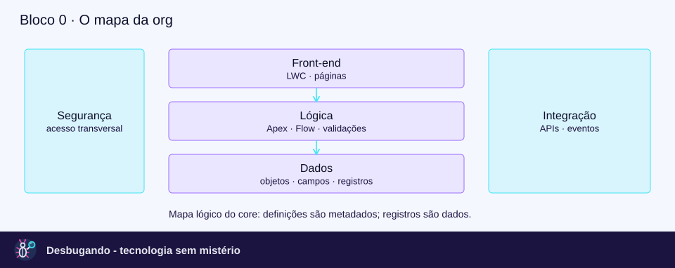

# Salesforce para engenharia back-end: mapa e percurso

Este arquivo é a porta de entrada curta para a conversa, não uma segunda versão do roteiro. A apresentação completa, as verificações de infraestrutura e os exemplos de arquivos estão no [roteiro principal](roteiro-sf-para-techs/roteiro-salesforce-backend.md); a [revisão da base](revisao-base-conhecimento.md) explica por que os trechos de conversa antes reunidos aqui foram consolidados.

## O mapa que vale fixar

Uma org é um ambiente lógico de uma plataforma multitenant orientada a metadados, não um servidor exclusivo. O projeto local representa componentes que podem ser implantados; a aplicação em uso depende das definições implantadas e dos serviços da plataforma, não do checkout do desenvolvedor ([arquitetura multitenant](https://architect.salesforce.com/docs/architect/fundamentals/guide/platform-multitenant-architecture.html)).

Use a frase “salvar `Pedido__c` e integrá-lo ao ERP” para localizar as responsabilidades abaixo. O pedido e todos os componentes citados são exemplos fictícios, não resultados de uma extração da org.

| Camada | Pergunta back-end | O que reconhecer |
|---|---|---|
| Dados | Qual é o contrato lógico? | Objetos, campos, relacionamentos, SOQL e DML. |
| Lógica | Quem calcula, valida e coordena? | Validation Rules, Flow, Apex e triggers. |
| Segurança | Quem opera sobre quais objetos, campos e registros? | CRUD, FLS, permissões, sharing e contexto do código. |
| Interface | Quem consome dados e lógica? | LWC, LDS/UI API e métodos Apex expostos à UI. |
| Integração | Onde estão contrato, autenticação e falhas? | APIs, credenciais, eventos e consumidores. |

Essa divisão é um mapa didático, não cinco processos isolados nem um desenho físico do banco. Para os mecanismos e as referências de cada camada, use os blocos correspondentes do [roteiro principal](roteiro-sf-para-techs/roteiro-salesforce-backend.md).

## Três distinções antes das siglas

- **Definição versus registro:** a definição de `Valor__c` é metadado; o valor de R$ 500 em um pedido é dado. Custom Metadata é um caso de configuração transportável, mesmo com aparência de registro ([Custom Metadata](https://developer.salesforce.com/docs/atlas.en-us.244.0.api_meta.meta/api_meta/meta_custommetadatatypes.htm)).
- **Fonte versus uso:** XML participa da representação de muitos componentes, mas Apex, JavaScript, HTML e outros recursos também integram o projeto. Metadado não é sinônimo universal de arquivo XML ([source format](https://developer.salesforce.com/docs/platform/sfdx-dev/guide/sfdx-dev-source-file-format.html)).
- **Gravação versus commit:** after trigger e caminho imediato de after-save Flow ainda participam do salvamento não confirmado. Queueable enfileirado para esse trabalho executa posteriormente, em outra transação ([ordem oficial](https://developer.salesforce.com/docs/platform/apex-dev/references/apex-dev/apex-triggers-order-of-execution.html)).

Analogia back-end: pense em uma plataforma gerenciada com modelo de domínio, políticas de acesso e pipeline transacional. A analogia não implica acesso ao SQL interno, ao sistema operacional ou ao banco físico.

## Como conduzir sem sobrecarregar

- **Abertura:** desenhe apenas as camadas; acrescente siglas quando a responsabilidade fizer sentido.
- **Exemplo contínuo:** em cada bloco, acrescente uma peça ao mesmo pedido, em vez de trocar o domínio.
- **Pausa de fixação:** peça “explique com suas palavras o que acontece ao salvar”. Use a resposta para escolher o próximo aprofundamento.
- **Navegação prática:** termine em um componente real da documentação; não presuma que classes com nomes parecidos são chamadas entre si.
- **Tempo:** use a distribuição e o recorte de trinta minutos do roteiro principal; não some novamente blocos completos e os apresente como uma sessão curta.

## Onde aprofundar

- **Metadados e runtime:** bloco 2 e “Três casos da org bananinha” no [roteiro principal](roteiro-sf-para-techs/roteiro-salesforce-backend.md).
- **SalesforceDB, Oracle, slots e Account:** seção de verificação de infraestrutura do mesmo roteiro; não inferir um schema físico a partir do modelo lógico.
- **Segurança e versão de API:** bloco 4 do roteiro; conferir a versão da classe e o modo das operações.
- **Transação e limites:** [guia de Order of Execution](orderOfExecution.md), com a sequência oficial e suas condições.
- **Critérios de evidência:** bloco 10 do roteiro; distinguir inventário estático, referência explícita e comportamento observado.

## Critério de sucesso

Ao terminar, o desenvolvedor deve localizar um campo, reconhecer uma automação, formular uma pergunta sobre acesso e desenhar uma fronteira transacional. Não precisa decorar o armazenamento interno da Salesforce nem todas as famílias de API para começar a trabalhar com a documentação.

Revisão: 11 de novembro de 2026. O conteúdo anterior permanece recuperável no histórico Git; este caminho foi preservado para não quebrar referências existentes.
