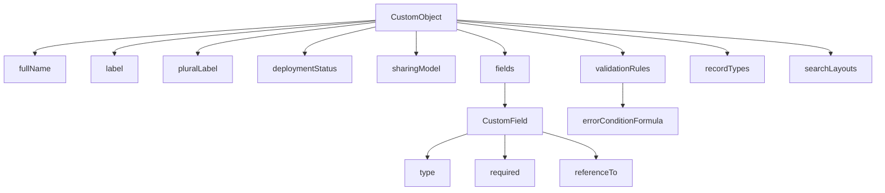
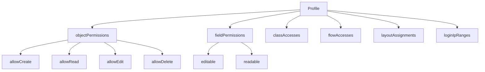

Sem escrever esse mapa completo, campo por campo, dentro de uma resposta de chat sem risco de omissão ou erro, podemos pensar numa maneira de fazer isso...

Afinal, existe uma diferença importante:

```text
“Mapear o CORE” = possível e recomendável
“Escrever todo o mapa em uma mensagem” = inviável e arriscado
```

O CORE pode ser mapeado de forma **completa, auditável e versionada** porque ele possui uma fonte formal: o **Metadata WSDL**, a documentação field por field do Metadata API Developer Guide e o **Metadata Coverage Report**. A própria Salesforce disponibiliza o WSDL em `https://yourInstance.salesforce.com/services/wsdl/metadata`, e a documentação confirma que `retrieve()` devolve a representação XML dos componentes da org. [apis](https://apis.io/apis/salesforce-sales-cloud/metadata-api/)

## O que significa mapear o CORE por completo

Para o CORE, o mapa completo teria estas camadas:

```text
1. Todos os metadata types do CORE
2. Todos os fields de cada metadata type
3. Todos os blocos aninhados
4. Todos os tipos de dado
5. Todos os domínios de valores
6. Obrigatoriedade e default
7. Relações entre metadata types
8. Cobertura por API version
9. Cobertura por retrieve, deploy, source tracking e package
10. Exemplos XML reais
```

Isso é viável como **artefato gerado**, por exemplo:

```text
metadata_types.csv
metadata_fields.csv
field_domains.csv
field_relationships.csv
api_coverage.csv
xml_examples/
graph.json
mermaid_graphs/
```

Não é viável como **uma resposta textual única**, porque o resultado seria dezenas de milhares de linhas e mudaria a cada release.

## Por que o CORE é mapeável

O CORE é mapeável porque possui três fontes complementares:

| Fonte | O que entrega | Limitação |
|---|---|---|
| **Metadata WSDL** | Estrutura formal: complexTypes, elements, tipos, obrigatoriedade e aninhamento | Não traz explicação didática nem label amigável |
| **Metadata API Developer Guide** | Descrição, exemplo XML, fields, tipos e comportamento | Extensa e atualizada por release |
| **Metadata Coverage Report** | Suporte por Metadata API, CLI, Change Set, source tracking e pacotes | Não substitui a documentação de fields |
| **`retrieve()` da org** | XML real dos componentes | Mostra o que existe na org, não o universo teórico de fields |

A documentação oficial explica que `deploy()` e `retrieve()` movem metadados em XML entre a org e o sistema de arquivos, e que o `retrieve()` retorna a representação XML dos componentes.  O WSDL é a base formal para gerar clientes e entender a estrutura dos tipos. [apis](https://apis.io/apis/salesforce-sales-cloud/metadata-api/)

## A escala real do CORE

Uma estimativa honesta:

```text
Metadata types do CORE: centenas
Fields totais, incluindo blocos aninhados: milhares a dezenas de milhares
Relações entre tipos: milhares
Domínios de valores: centenas
Exemplos XML: centenas
```

Por exemplo, apenas `CustomObject` já contém blocos como:

```text
fields
validationRules
recordTypes
businessProcesses
listViews
webLinks
fieldSets
compactLayouts
searchLayouts
sharingRules
actionOverrides
indexes
platformEventChannel
```

E cada um desses blocos tem seus próprios fields. `CustomField`, por sua vez, tem dezenas de propriedades e subtipos conforme o `type` escolhido.

## Como gerar o mapa completo do CORE

### Passo 1 — Fixar a API version

Escolha uma versão-alvo, por exemplo:

```text
API version 63.0
```

Sem isso, “completo” não tem significado estável, porque a Salesforce adiciona e altera metadata types a cada release. As release notes oficiais documentam continuamente novos e alterados metadata types. [developer.salesforce](https://developer.salesforce.com/docs/atlas.en-us.api_meta.meta/api_meta/file_based.htm)

### Passo 2 — Baixar o WSDL

```text
https://suaInstancia.salesforce.com/services/wsdl/metadata
```

O WSDL descreve formalmente os tipos e campos da Metadata API. [apis](https://apis.io/apis/salesforce-sales-cloud/metadata-api/)

### Passo 3 — Extrair a estrutura

Do WSDL, extraia automaticamente:

```text
complexType → metadata type
element → field
minOccurs → obrigatório ou opcional
maxOccurs → singular ou lista
type → tipo de dado
restriction → domínio de valores
sequence → ordem dos filhos
choice → alternativas
```

### Passo 4 — Cruzar com a documentação

Para cada field, cruze com a documentação oficial para obter:

```text
label amigável
descrição
explicação didática
exemplo
default
comportamento em deploy
relação com outros tipos
```

A documentação oficial traz, para cada metadata type, tabelas do tipo `Field Name | Field Type | Description`, como em `CustomApplicationComponent`. 

### Passo 5 — Cruzar com o Metadata Coverage Report

O relatório oficial mostra quais tipos funcionam com:

```text
Metadata API
Salesforce CLI
Change Sets
Source Tracking
Unlocked Packages
```

Ele é a fonte autoritativa de cobertura e compatibilidade entre ferramentas. [help.salesforce](https://help.salesforce.com/s/articleView?id=release-notes.rn_ls_new_metadata_api.htm&language=en_US&release=244&type=5)

### Passo 6 — Gerar os artefatos

```text
metadata_types.csv
metadata_fields.csv
field_domains.csv
field_relationships.csv
api_coverage.csv
graph.json
mermaid_graphs/
xml_examples/
```

## Modelo de grafo para o tutorial

Para o tutorial visual, cada metadata type vira um nó e cada field vira um nó filho.



E para segurança:



Esse formato funciona para quem conhece Salesforce e para quem não conhece, porque mostra a **estrutura**, não apenas nomes técnicos.

## Exemplo de ficha completa

Para cada metadata type, o material teria esta estrutura:

```markdown
## CustomObject

### Identificação
- Metadata type: CustomObject
- Arquivo: .object-meta.xml
- Categoria: Dados e modelo relacional
- API version mínima: variável por field
- Suporte: retrieve, deploy, source tracking, package — validar por versão

### Finalidade
Define um objeto customizado, seu comportamento, campos, relacionamentos,
validações, layouts e configurações de acesso.

### Fields de primeiro nível
| Field | Label | Tipo | Obrigatório | Default | O que configura | Valores |

### Blocos aninhados
| Bloco | Tipo filho | Cardinalidade | Finalidade |

### Domínios
| Field | Valor | Significado |

### Relações
| Relaciona-se com | Tipo de relação | Finalidade |

### Exemplo XML
XML completo.

### Grafo
Mermaid.

### Cuidados de CTA
Segurança, performance, integração, deploy e governança.
```

## O que eu recomendo fazer agora

Para transformar isso no seu tutorial, o caminho mais sólido é:

1. **Escolher a API version-alvo.**
2. **Baixar o `metadata.wsdl`.**
3. **Gerar o inventário completo de complexTypes e fields.**
4. **Cruzar com a documentação oficial.**
5. **Cruzar com o Metadata Coverage Report.**
6. **Gerar CSV, JSON, Mermaid e exemplos XML.**
7. **Publicar por lotes**, começando pelo Grupo 1 e seguindo até os produtos separados.

## Resposta direta

- **Sim, o CORE pode ser mapeado por completo.**
- **Não, não dá para escrever esse mapa completo inteiro em uma resposta de chat com fidelidade garantida.**
- **O material correto é um dicionário gerado por máquina, versionado por API version e publicado em lotes.**
- **A fonte de verdade é:** Metadata WSDL + Metadata API Developer Guide + Metadata Coverage Report + `retrieve()` da org. [apis](https://apis.io/apis/salesforce-sales-cloud/metadata-api/)

Se você quiser, o próximo passo pode ser eu montar o **esqueleto completo do projeto de referência**, já com:

```text
estrutura de pastas
modelo de CSV
modelo de JSON
modelo de grafo Mermaid
script Python para extrair fields do metadata.wsdl
script Python para gerar CSV/JSON
template de ficha por metadata type
```

Assim você terá a base técnica para gerar o mapa completo do CORE — e depois estender para Marketing Cloud, B2C Commerce, MuleSoft, Tableau, Slack, Data Cloud e Agentforce.
